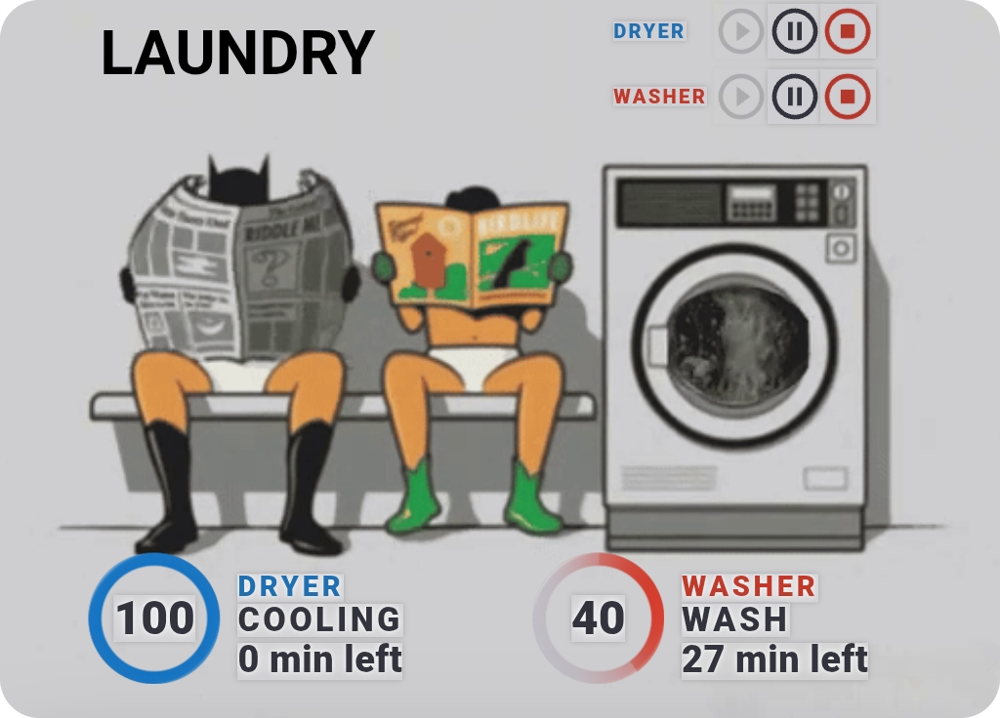
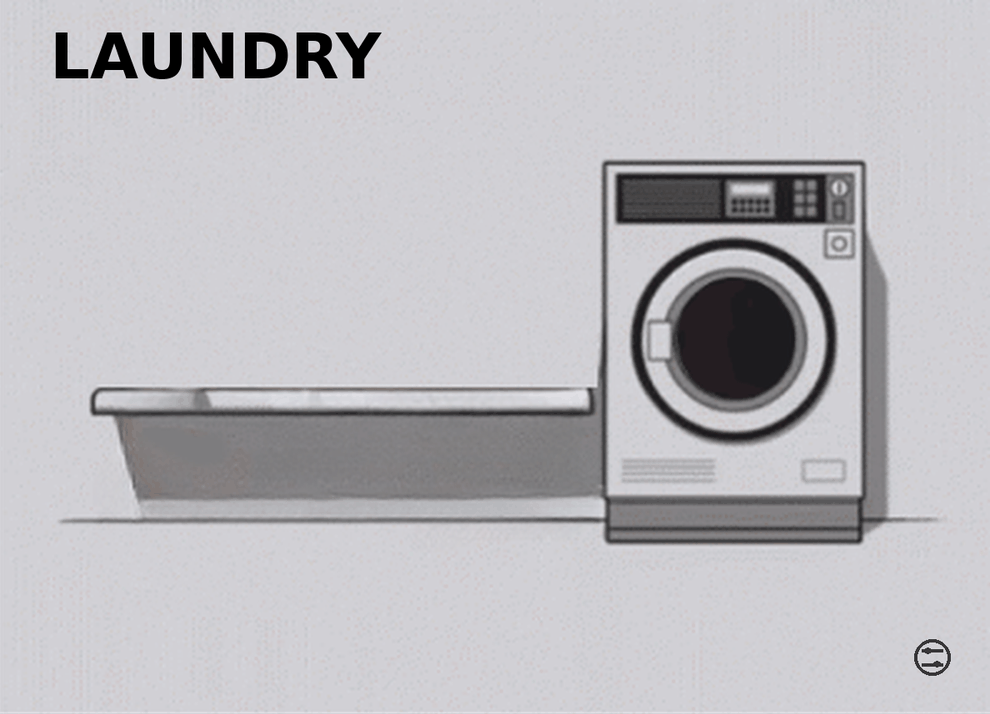
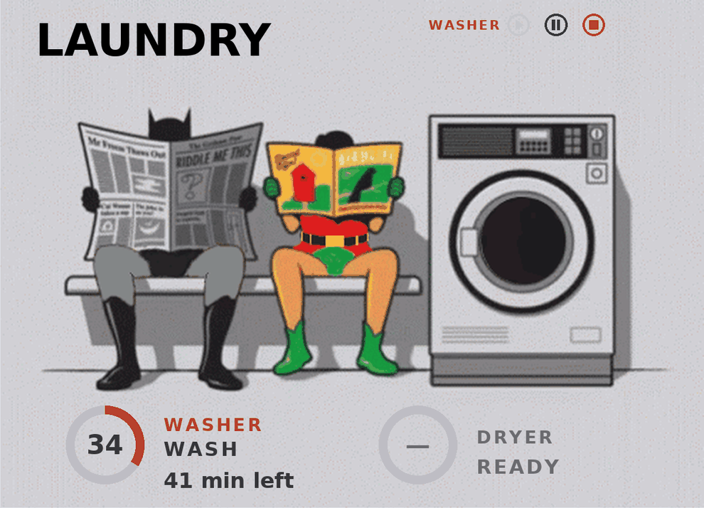
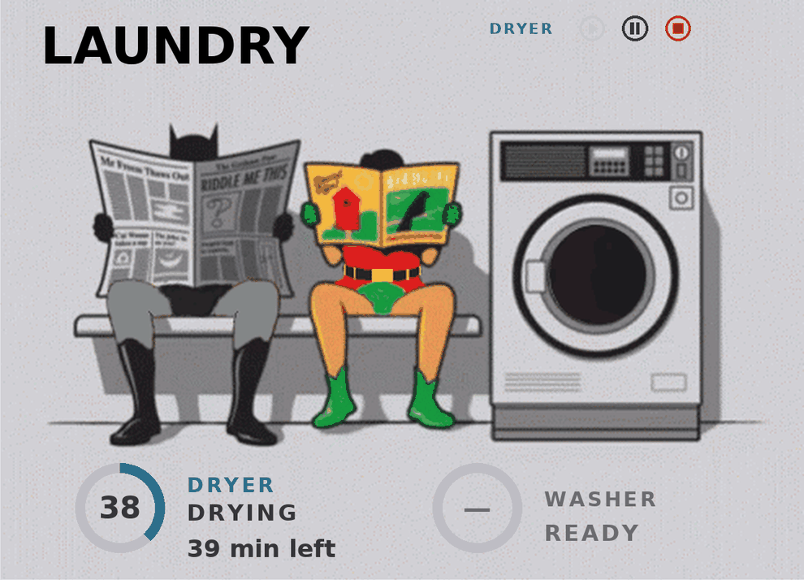
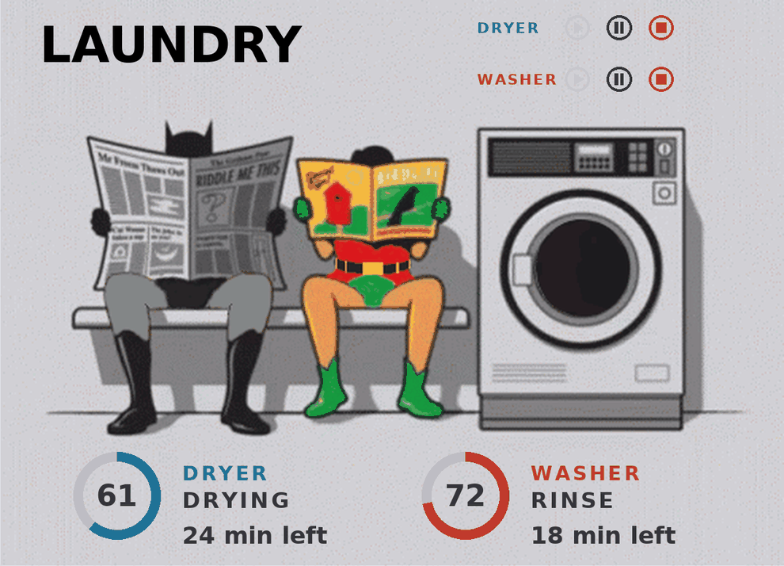
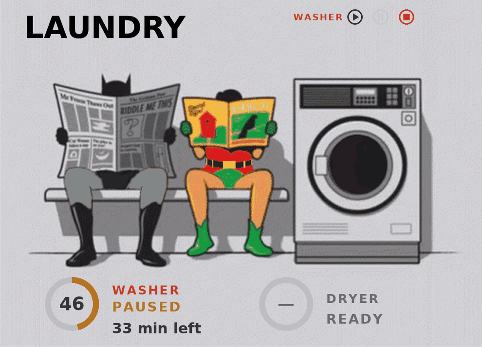
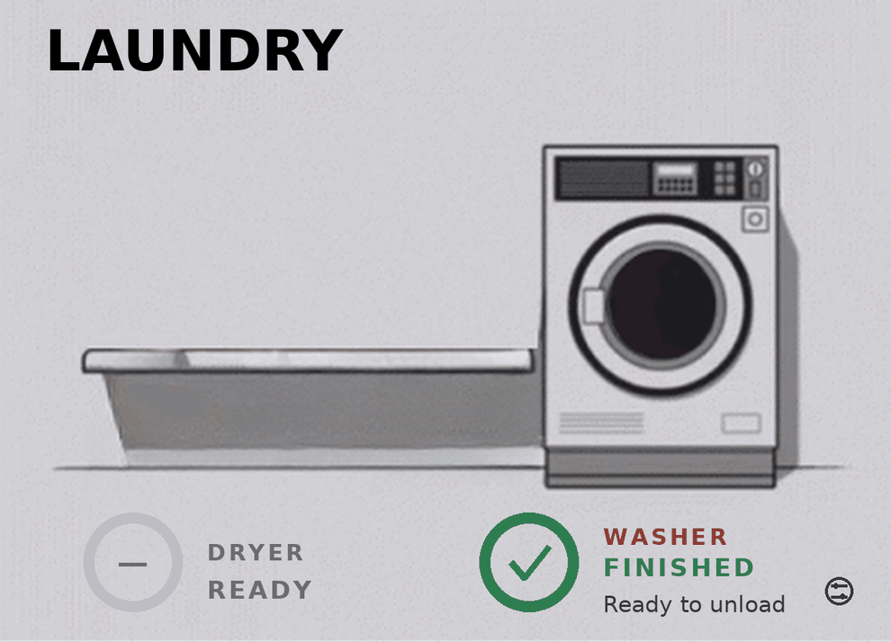

<div align="center">



# Batman Laundry Card

**Batman and Robin wait on the bench while your washer and dryer do the work.**
A Batman-themed laundry dashboard card for Home Assistant, with live progress rings, quick controls and pop-ups.


</div>

> The hero image above is a real screenshot of the card running on a phone (washer at 40 percent, dryer in its cooling stage). The state gallery further down uses *design previews*, not live screenshots.

## Features

- **Two permanent status slots at the bottom** with circular progress rings: percent, machine name, current stage and "N min left". Dryer is blue, washer is red.
- **Smart slot layout.** When only one machine runs it takes the left slot. The idle machine shows READY on the right while the other one runs. When both are off, only a small controls icon is left in the bottom right corner.
- **Play / pause / stop rows** above the washer for every running machine, stacked when both run (uses `button.press` on the machine's button entities).
- **Clear states.** Paused turns the ring amber, finished shows a green check ("Ready to unload"), and an alarm shows a red `!`.
- **Animated art.** Batman and Robin sit on the bench, the washer drum animates through the wash, rinse and spin stages, and a "done" animation plays when a cycle ends.
- **Tap for details.** Tap the picture or a slot to open a [Browser Mod](https://github.com/thomasloven/hass-browser_mod) pop-up with that machine's controls, settings and maintenance entities. Tap the small icon in the corner when everything is idle to open a combined pop-up.
- **Editable title.** The "LAUNDRY" label in the corner comes from an `input_text` helper, so you can rename it any time.
- **Mostly plain YAML.** No custom JavaScript card of its own: it is a built-in `picture-elements` card plus `custom:button-card` for the rings.

## Gallery

These are **design previews** rendered to show each layout. They are not live screenshots, so fonts differ slightly from a real dashboard.

| All off | Washer only |
|:---:|:---:|
|  |  |
| **Dryer only** | **Both running** |
|  |  |
| **Paused (amber)** | **Finished (green)** |
|  |  |

An alarm shows the same slot with a red ring and a `!` instead of the percentage.

## Requirements

| Requirement | Why | Where to get it |
|---|---|---|
| Home Assistant `picture-elements` card | The card itself | Built in |
| `custom:button-card` | Progress rings and text labels | HACS (Frontend), "button-card" |
| Browser Mod | Pop-ups when you tap the picture or a slot | HACS (Integration), "Browser Mod". Set it up as described in its own README |
| A washer and dryer that expose the entities in the [entity table](#entity-mapping) | Live data and controls | Samsung / SmartThings style entities work out of the box (see [other brands](#works-with-other-brands)) |
| `input_text.laundry_label` helper | Title text | [`configuration/input_text.yaml`](configuration/input_text.yaml) |

Without Browser Mod the card still shows everything, but tapping to open pop-ups does nothing.

## Quick install

1. **Copy the images.** Create the folder `/config/www/batman-laundry-card/` on your Home Assistant and copy **everything inside this repo's [`images/`](images/) folder** into it (the PNGs and the GIFs). Home Assistant serves that folder as `/local/batman-laundry-card/`. If `/config/www` did not exist before, restart Home Assistant once.
2. **Install the HACS frontend pieces:** `button-card` and Browser Mod. Reload the browser (hard refresh) afterwards.
3. **Add the helper.** Either paste [`configuration/input_text.yaml`](configuration/input_text.yaml) into `configuration.yaml` and restart, or create a Text helper named **Laundry Label** in the UI (Settings, Devices & services, Helpers).
4. **Add the card.** Edit your dashboard, add a **Manual** card and paste the contents of [`card/batman-laundry-card.yaml`](card/batman-laundry-card.yaml).
5. **Replace the two entity prefixes** with your own, see the next section.

Image paths are always `/local/batman-laundry-card/...`. Do not put your Home Assistant IP address or cloud URL in front of them (see [Troubleshooting](#troubleshooting)).

## Find and replace these two prefixes

The card was built for one Samsung washer and one Samsung dryer. Every entity ID in it starts with one of two prefixes. In the card editor (or your text editor) do a find and replace:

| Find | Replace with |
|---|---|
| `samsung_washer_da_wm_tp1_21_common_` | your washer prefix, for example `my_washer_` |
| `samsung_dryer_da_wm_tp1_21_common_` | your dryer prefix, for example `my_dryer_` |

How to find your prefix: open Settings, Devices & services, Entities and search for your washer. Entity IDs look like `sensor.<prefix>progress`, `sensor.<prefix>machine_state` and so on. Everything before the role name (`progress`, `machine_state`, ...) is the prefix, **including the trailing underscore**.

Two things to know:

- **Pop-up rows that start with `hallway_`.** A handful of pop-up entities in the author's install have IDs such as `select.hallway_samsung_washer_da_wm_tp1_21_common_soil_level`. After the find and replace they will look like `select.hallway_my_washer_soil_level`, which most people do not have. Fix those rows or delete them; the main card does not depend on them. The affected rows are listed in the [pop-up entity table](#pop-up-entities).
- If your washer and dryer use entity IDs that do not share a common prefix, remap the roles one by one instead, see [Works with other brands](#works-with-other-brands).

## Entity mapping

These are the roles the card needs for **each** machine. `<prefix>` is the washer or dryer prefix from above.

| Role | Default entity | What the card does with it |
|---|---|---|
| `running` | `binary_sensor.<prefix>running` | `on` while a cycle runs. Drives the animated art layers |
| `machine_state` | `sensor.<prefix>machine_state` | Expected values: `active`, `pause`, `idle`. Chooses the layout (ring, PAUSED, READY, controls) |
| `progress` | `sensor.<prefix>progress` | Current stage as text, shown under the name. The washer art switches on `prewash`, `wash`, `rinse`, `spin`, `predrain`, `weightsensing`. The value `finish` means finished |
| `progress_percent` | `sensor.<prefix>progress_percent` | 0 to 100, fills the ring and is shown in its middle |
| `completion_time` | `sensor.<prefix>completion_time` | Printed as `<state> min left`, so it must be a **number of minutes** (see [timestamp sensors](#my-completion-time-is-a-timestamp)) |
| `alarm_code` | `sensor.<prefix>alarm_code` | `none` means fine. Any other value shows the red ALARM state |
| `start` button | `button.<prefix>start` | Play icon (when paused) and the pop-up Start button |
| `pause` button | `button.<prefix>pause` | Pause icon |
| `stop` button | `button.<prefix>stop` | Stop icon and the pop-up Stop button |
| title helper | `input_text.laundry_label` | The "LAUNDRY" label |

The control icons and pop-up buttons call `button.press` on these entities, so Home Assistant will really start, pause or stop your machines. Resume, Stop and the pop-up Start and Stop buttons ask for confirmation first. Pause does not.

### Pop-up entities

The pop-ups list extra entities. They are only used inside the pop-ups, so a missing one just shows as unavailable. Remove any you do not have.

| Machine | Entities (after the prefix, unless noted) |
|---|---|
| Washer, usage text | `sensor.<prefix>energy`, `sensor.<prefix>water_consumption` (shown in gallons), `sensor.<prefix>drum_clean_due_in` |
| Washer, settings | `select.<prefix>cycle`, `select.<prefix>wash_temperature`, `select.<prefix>spin_speed`, `select.<prefix>rinse_cycles`, `number.<prefix>delay_start`, and with the `hallway_` quirk: `select.hallway_<prefix>soil_level`, `select.hallway_<prefix>laundry_out_reminder`, `time.hallway_<prefix>finish_by` |
| Washer, status | `binary_sensor.<prefix>detergent_low`, `sensor.<prefix>alarm_code`, `binary_sensor.<prefix>firmware_update_available`, `button.<prefix>start_diagnosis`, and with the quirk: `binary_sensor.hallway_<prefix>child_lock`, `sensor.hallway_<prefix>drum_last_cleaned` |
| Dryer, usage text | `sensor.<prefix>energy`, and with the quirk: `select.hallway_<prefix>dry_level` |
| Dryer, settings | `select.<prefix>cycle`, `switch.<prefix>wrinkle_prevent`, `number.<prefix>delay_start`, and with the quirk: `select.hallway_<prefix>dry_level`, `switch.hallway_<prefix>damp_alert`, `time.hallway_<prefix>finish_by` |
| Dryer, status | `sensor.<prefix>alarm_code`, `binary_sensor.<prefix>firmware_update_available`, and with the quirk: `binary_sensor.hallway_<prefix>child_lock`, `binary_sensor.hallway_<prefix>wrinkle_prevent_active` |

## Works with other brands

Nothing in the card is brand specific except the entity IDs. To use another washer or dryer (LG, Miele, Bosch, a smart plug with power monitoring, ...), map each role in the table above to something you have:

1. Look at your entities in Settings, Devices & services, Entities, and decide which one matches each role.
2. Do a find and replace on each full entity ID in the card YAML, for example `sensor.samsung_washer_da_wm_tp1_21_common_progress` to `sensor.my_washer_cycle_phase`.
3. If a role does not exist, **create it with a template helper** that produces the values the card expects:
   - `machine_state` must output `active`, `pause` or `idle`.
   - `progress` is free text for display. Only `finish` (finished) and the washer stage names above have a special meaning.
   - `progress_percent` must be a number from 0 to 100.
   - `completion_time` must be a number of minutes.
   - `alarm_code` must be `none` when everything is fine.
   - `running` must be a `binary_sensor` that is `on` while the machine runs.
4. If your machine has no start, pause or stop buttons, delete the matching icons and pop-up buttons, or change their `tap_action` to something your machine supports.

Heads up: this card has only been used with the author's Samsung washer and dryer, so mappings for other brands are your own adventure. Pull requests with working mappings are welcome.

## My completion time is a timestamp

Some Samsung / SmartThings integrations expose the finish time as a timestamp (for example `2026-10-24T18:30:00+00:00`), not as minutes. The card needs minutes. Use the template sensors in [`docs/legacy-template-sensors.yaml`](docs/legacy-template-sensors.yaml). Here is the washer one:

<details>
<summary>Modern template sensor (click to expand)</summary>

```yaml
# configuration.yaml
template:
  - sensor:
      - name: "Laundry Washer Minutes Left"
        unique_id: laundry_washer_minutes_left
        unit_of_measurement: "min"
        device_class: duration
        state_class: measurement
        state: >
          
          
            0
          
            {{ [((finish - as_timestamp(now())) / 60) | round(0, 'ceil') | int, 0] | max }}
          
```

Add a second sensor the same way for the dryer (the file has both). Then in the card YAML:

1. Replace the entity `sensor.<prefix>completion_time` of each machine with `sensor.laundry_washer_minutes_left` or `sensor.laundry_dryer_minutes_left` in the `custom:button-card` elements.
2. Search for `completion_time` in the pop-up text templates (they build the entity ID as `states(e~'completion_time')`) and replace that part with `states('sensor.laundry_washer_minutes_left')` or the dryer equivalent.

</details>

## Customization

- **Colors.** Search the YAML for the hex codes: dryer blue `#1f6fb2`, washer red `#c0392b`, paused amber `#b07014`, finished green `#2e7d50`, alarm red `#b5372b`, ring track `#bebdc4`, main text `#33333d`.
- **Positions are percentages of the 400 x 288 artwork.** Multiply the horizontal percentage by 4 and the vertical one by 2.88 to get pixels in the original image. Current values:

  | Item | `left` | `top` |
  |---|---|---|
  | Left ring center | 15.75% | 86.81% |
  | Right ring center | 59.75% | 86.81% |
  | Left slot text (name, stage, minutes) | 24% | 82.64%, 87.15%, 92.71% |
  | Right slot text | 68% | 82.64%, 87.15%, 92.71% |
  | Control row 1 (name, play, pause, stop) | 61.25%, 73.9%, 79.2%, 84.5% | 4.86% |
  | Control row 2 | same as row 1 | 13.89% |
  | Idle controls icon | 94.2% | 91.3% |
  | "LAUNDRY" title | 24% | 8% |

  The same position appears in several conditional blocks (one per state), so when you move something, search and replace the value everywhere.
- **Ring size.** The ring is a 48 px circle made with a `conic-gradient` and a mask. Change `width` and `height` in the ring element's `styles`.
- **Title.** Change the text of `input_text.laundry_label`. Font size and color are on the `state-label` element.
- **Your own art.** Replace `Batman_Laundry_Empty.png` and keep the picture at 400 x 288, or adjust the percentages above.

## Troubleshooting

**Image is cropped, offset, or I see a double image (issue [#1](https://github.com/afcragg78/batman-laundry-card/issues/1)).**
- Use `/local/batman-laundry-card/...` paths and copy the images into `/config/www/batman-laundry-card/`. Do not put an address (your IP and port, or a cloud URL) in front of the path. A LAN address only works at home, and an external address needs an internet round trip.
- To check a file is served, open `<your-HA-address>/local/batman-laundry-card/Batman_Laundry_Empty.png` in a browser. You should see the empty bench.
- The v2 card does not use a `panel` option, and its size comes from the base image, which is how `picture-elements` sizes itself. The old v1 stacked an extra empty-bench image on top of the base image, which could show up as a shifted second copy.
- In a **panel** view the card is stretched to the full screen width and can look huge. Use a masonry or sections view, or put the card in a narrower column. In a **sections** view, give the card enough columns for its width.
- Clear the browser cache (hard refresh) after replacing images, or add `?v=2` to the image paths.

**"Custom element doesn't exist: button-card".** Install `button-card` from HACS, make sure its resource is added, and hard refresh.

**Tapping does nothing.** Pop-ups need Browser Mod (installed and set up). Control icons only show for machines that are running or paused.

**Pop-up rows show "Entity not available".** Those entities do not exist on your system. Remove the rows or remap them, see [Pop-up entities](#pop-up-entities).

**"N min left" shows a long date, 0 or unknown (issue [#2](https://github.com/afcragg78/batman-laundry-card/issues/2)).** Your completion sensor is a timestamp, so use the [minutes template sensors](#my-completion-time-is-a-timestamp). If Home Assistant refused to start after you pasted the old `Config YAML.txt`, that file used the legacy template syntax (`sensor: - platform: template` with `name`, `state` and `state_class` keys) which current versions reject. It has been removed. The modern `template:` syntax in `docs/legacy-template-sensors.yaml` replaces it.

**The card loads slowly the first time.** The animated GIFs are a few megabytes each (the largest is over 3 MB). After the first load they are cached by the browser.

**Nothing updates.** Check that the prefixes are replaced everywhere. In Developer tools, States, look up one of your entities and compare it with the table above.

## Known limitations

- Built around one Samsung washer and dryer (entity IDs like `*_da_wm_tp1_21_common_*`). It has not been tried by the author on other brands or models.
- Some pop-up entity IDs contain a `hallway_` segment that is specific to the author's install, see above.
- The YAML is long (several thousand lines) because every state is its own conditional block with its own positions. Edits to positions or text have to be repeated in each block.
- `completion_time` must already be minutes. The card does not convert timestamps itself.
- The animated washer art switches on the stage names `prewash`, `wash`, `rinse`, `spin`, `predrain` and `weightsensing`. If your machine uses other stage names, the ring and text still work but the animation will not change.
- The GIF file names are historical. For example the `wash` stage plays `Batman_Laundry_Rinse.gif` and `rinse` plays `Batman_Laundry_Sin.gif`. The "done" animation is `Batmn_Laundry_Done.gif` (the typo is kept on purpose so existing installs keep working).
- Pop-up text shows water in gallons and energy in kWh. Edit the text templates for liters.
- The gallery pictures are design previews, not live screenshots.

## Version 1 (original design)

The original v1 card (2025) used `switch` entities and "job state" sensors with a simple text overlay. It is kept in [`legacy/`](legacy/) for reference. This video shows the **original v1 design**, not v2:

[](https://www.youtube.com/watch?v=hIn9QnNpZ2Y)

## Changelog

See [CHANGELOG.md](CHANGELOG.md).

## Credits

- Artwork and animations: the Batman and Robin laundry scene files in [`images/`](images/). The idle image was cleaned up for v2.
- Built on Home Assistant's `picture-elements` card, [button-card](https://github.com/custom-cards/button-card) by RomRider, and [Browser Mod](https://github.com/thomasloven/hass-browser_mod) by Thomas Loven.
- Thanks to everyone who reported issues on v1, which shaped the v2 fixes.
- Made by [@afcragg78](https://github.com/afcragg78).
